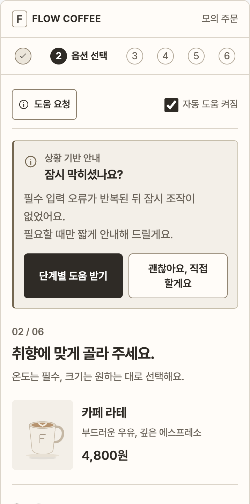

# KioskFlow Rescue

**주문 중 망설임을 발견하고, 사용자 통제와 고객사 손익으로 도움의 가치를 검증하는 키오스크 포트폴리오.**

NICE인프라 무인솔루션기획실 지원용 개인 비공식 제안입니다. 실제 납품·협력·인증·실매장 성과가 아닙니다. AI 학습이나 유료 API 없이 동작하는 **규칙 기반 정적 웹앱**입니다.

> 모든 개발·제출물은 [`feature/autonomous-build`](https://github.com/hyollim/kioskflow-rescue/tree/feature/autonomous-build)에 있습니다. `main`은 변경하지 않았습니다.

## 바로 체험하고 살펴보기

- **[한국어 B2B 사업제안서 PDF · 13쪽](deliverables/KioskFlow_Rescue_B2B_Proposal_KO.pdf)**
- **[단일 HTML 데모 내려받기](deliverables/kioskflow-rescue-standalone.html)**: JS/CSS/Pretendard 폰트와 OFL 라이선스 내장. GitHub HTML 소스 보기 대신 파일을 내려받아 브라우저에서 열 수 있도록 구성했습니다. 같은 파일의 HTTP 제공 실행은 확인했으며, Aside Browser의 `file://` 직접 열기는 권한 제한으로 미검증입니다.
- **검증한 로컬 데모:** `npm ci && npm run build && npm run preview -- --port 4173` 후 http://127.0.0.1:4173/kioskflow-rescue/
- **공개 배포 [blocked]:** https://hyollim.github.io/kioskflow-rescue/ 는 현재 404. 저장소 Pages 비활성화/Branch=None을 직접 확인했고 설정·권한은 변경하지 않았습니다. [배포 상태·추후 절차](docs/DEPLOYMENT.md)



## Premium Enterprise Minimal 리디자인

운영 플랫폼은 뉴트럴/화이트와 제한적인 파란 활성색, 고객 주문은 아이보리/차콜로 구분했습니다. 본문 최소 14px, 고객 주문 조작 44px 이상과 일관된 포커스·오류 상태를 검증했습니다. 기존 수식·지원 규칙은 유지했습니다.

[리디자인 보고서](docs/REDESIGN_REPORT.md) · [Before/After PDF · 11쌍](deliverables/KioskFlow_Rescue_UI_Redesign_Review.pdf) · [원본 비교](public/redesign/comparison.json)

## 90초 시연 경로

1. **키오스크 체험:** A로 주문 시작 → 음료 → HOT/ICE·크기 → 장바구니 수량/옵션 수정 → 검토 → 모의 결제 확인란 → 완료. 실제 결제정보는 받지 않습니다.
2. **A/B/C 비교:** B는 직접 도움 요청만, C는 자동 제안+수동 도움. ‘빠른 데모 시나리오’에서 옵션 실패 또는 왕복을 재현해 수락·거절을 확인합니다. 정상 대기만으로는 개입하지 않습니다.
3. **운영 대시보드:** 실제 체험 / 데모 시나리오 / 가상 비교 데이터를 따로 봅니다. 합성 12세션은 A/B/C 완료율을 의도적으로 같게 만들었으며 실험 결과가 아닙니다.
4. **사업성 분석:** 기준·보수·부정 가정과 이용료 등 입력을 바꿔 순편익·회수기간·ROI·권고 전환을 확인합니다. 기준 +628,000원/월, 부정 −2,217,000원/월은 **임의 가정의 계산 예시**입니다.

## 무엇을 검증하는가

| 방식 | 직접 도움 | 자동 개입 | 비교 목적 |
| --- | --- | --- | --- |
| A 기본형 | 없음 | 없음 | 기본 UI 기준선 |
| B 상시 도움형 | 가능 | 없음 | 사용자 요청 기반 대안 |
| C 상황 인지형 | 가능 | 복합 신호·억제 조건 | B 대비 추가 가치와 오탐 비용 |

오류·왕복·수정과 비활동을 조합하고, 단독 대기는 개입하지 않습니다. 거절한 주문에는 자동 재제안을 멈추며 수동 요청은 남깁니다. 기존 NICE의 낮은 화면·저시력·음성주문 기능을 새로 만든 것처럼 주장하지 않습니다.

## 핵심 의사결정

- LLM/생체 분석 대신 설명 가능한 규칙으로 비용·개인정보·운영복잡도를 낮춤. [설계 선택](docs/DESIGN_DECISIONS.md), [규칙](docs/RULES.md)
- 완료율 분모에서 미종료 세션 제외, 빈 데이터는 ‘—’. 도움 이후 완료율은 인과효과가 아님. [KPI 정의](docs/KPI_DEFINITIONS.md)
- 고객 증분 손익과 공급사 BM 분리. 초기비 중복 차감 방지, 음수 순편익/과도 오개입이면 보류. [사업모델·수식](docs/BUSINESS_MODEL.md)
- 실제 체험과 가속·합성 데이터를 분리. 익명 로컬 이벤트만 저장하며 초기화/저장 실패 fallback 제공.

## 실제 검증 결과

리디자인 최종 QA 기준 **13개 테스트 파일 / 103개 테스트 통과**, TypeScript와 production build 통과. 실제 Aside 브라우저에서 주문 완료, 필수 옵션 오류, C 시나리오·도움, 출처별 대시보드, 입력 변경과 부정 손익을 확인했습니다. PDF는 한글 텍스트/렌더링·13쪽과 레이아웃을 검사했습니다. 390/768/1440px, 56개 상태의 주요 화면·확대·키보드 점검과 프로젝트 의존성 감사 0건을 확인했습니다. [최종 QA](docs/QA_REPORT.md)와 [실제 테스트 보고서](docs/TEST_REPORT.md)에 기록합니다. 실행하지 않은 실매장/하드웨어 시험을 통과로 표시하지 않습니다.

## 개발·재현

Node 22.12+ / npm. macOS와 Linux용 명령입니다.

```sh
npm ci
npm test
npm run build
npm run preview -- --port 4173
# 개발 서버
npm run dev
# 빌드 후 단일 HTML 재생성
node scripts/make-standalone.mjs
# 제안서 HTML 생성 (PDF 출력은 브라우저 인쇄)
node --experimental-strip-types scripts/build-proposal.mjs
# dist·제출물·스크린샷만 제공하는 loopback 정적 서버
node scripts/serve-preview.mjs
```

프로젝트 `.npmrc`는 설치 스크립트/선택 네이티브 모듈을 제외합니다. esbuild/Rollup은 프로젝트 한정 WASM override를 사용합니다. macOS 보안 속성·전역 설정은 변경하지 않았습니다. 테스트는 Node Web Storage와 jsdom 충돌을 피하도록 해당 테스트 프로세스에만 호환 옵션을 전달합니다.

## 문서와 산출물

[PRD](docs/PRD.md) · [시장·경쟁 조사/출처](docs/MARKET_RESEARCH.md) · [설계](docs/DESIGN_DECISIONS.md) · [사업모델](docs/BUSINESS_MODEL.md) · [실증 계획](docs/PILOT_PLAN.md) · [파트너 전략](docs/PARTNER_STRATEGY.md) · [KPI](docs/KPI_DEFINITIONS.md) · [테스트](docs/TEST_REPORT.md) · [한계](docs/LIMITATIONS.md) · [단계 기록](docs/PROGRESS.md)

## 한계와 후속 검증

실제 효과·사용자 연구·POS/직원 호출·실결제·접근성 인증은 없습니다. 규칙 임계값·시장 수요·통합비는 현장 검증 전이며, 로컬 로그는 멀티탭 병합/운영 DB를 대체하지 않습니다. 다음 단계는 고객 인터뷰 → 베이스라인 → A/B/C 균형 실증 → 보수 손익과 운영 안전성으로 Go/No-Go 결정입니다.
